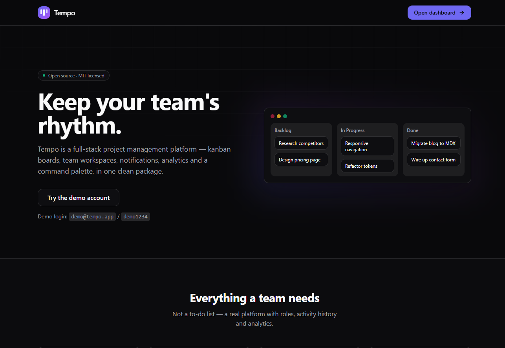
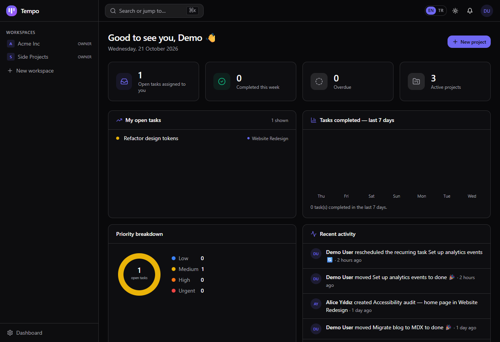
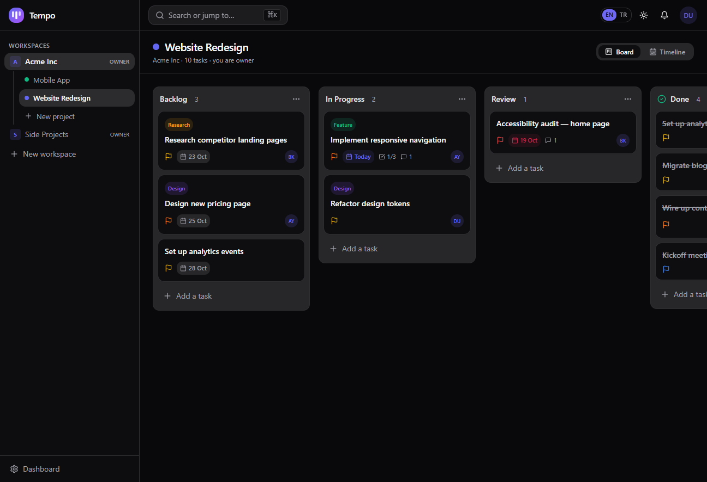
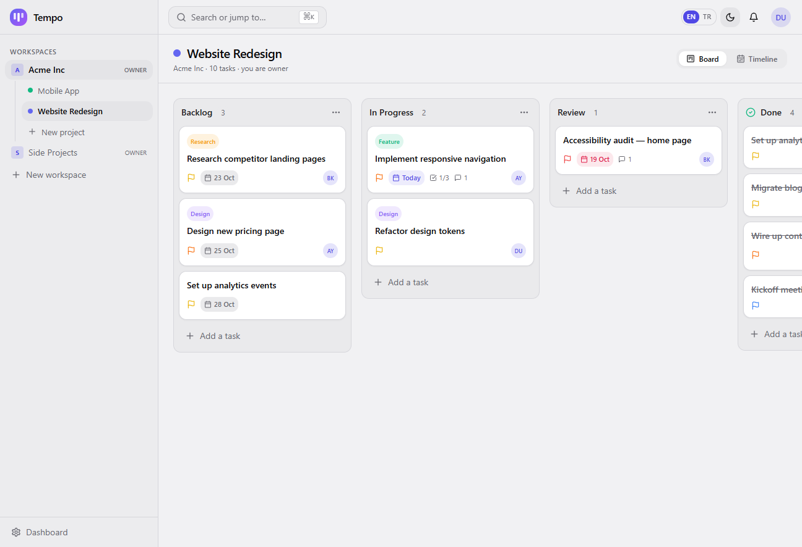
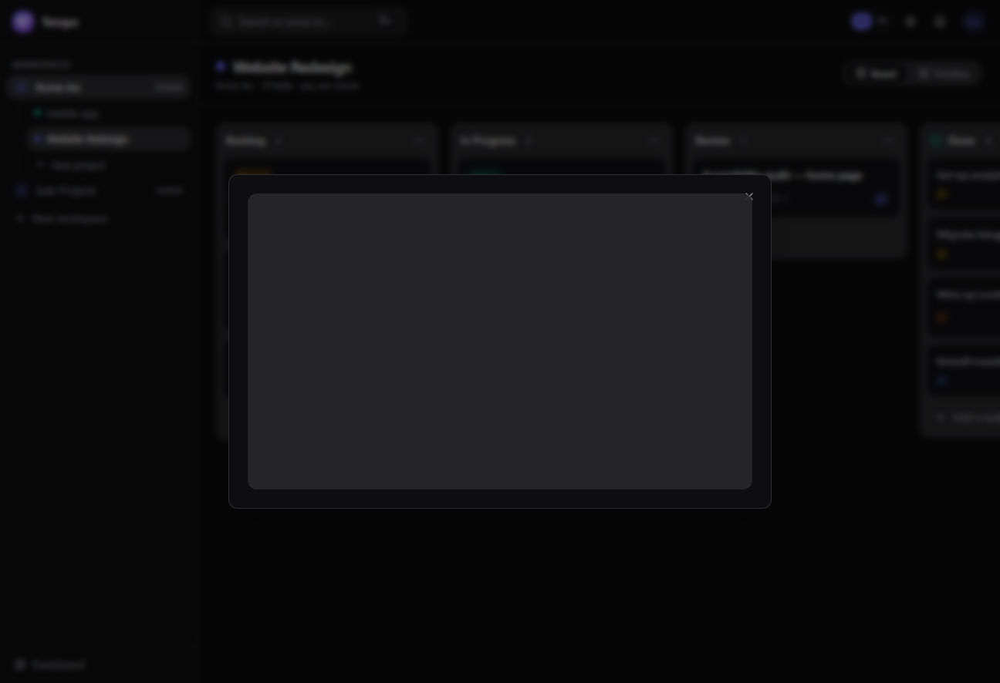
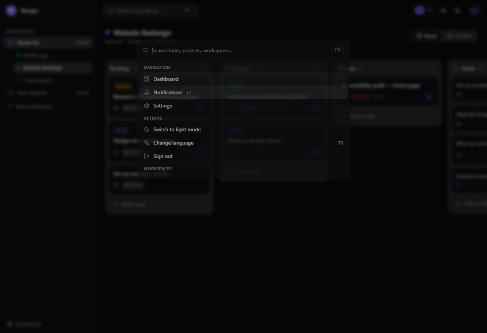
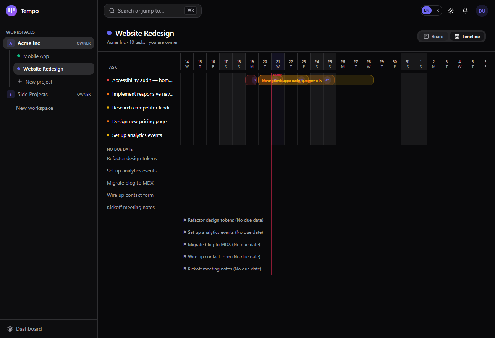
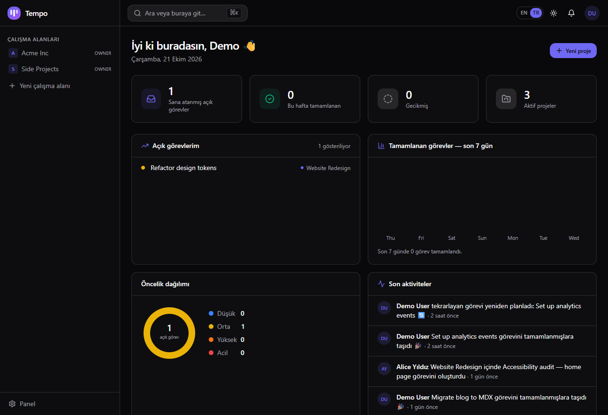

<p align="center">
  
</p>

<h1 align="center">Tempo</h1>

<p align="center">
  <b>A modern, full-stack project & task management platform.</b><br/>
  Kanban boards · Team workspaces · Invites · Notifications · Analytics · Command palette
</p>

<p align="center">
  
  
  
  
  
</p>

---

Tempo is a **complete SaaS-style project management platform** — not a to-do list. It ships with
drag & drop kanban boards, multi-tenant workspaces with roles and invite links, an activity feed,
in-app notifications, a dashboard with analytics charts, a ⌘K command palette and a carefully tuned
dark mode.

Built end-to-end with a production-grade stack: **Next.js 14 (App Router) · TypeScript · Prisma ·
NextAuth · React Query · Tailwind CSS · Zod · Vitest · Docker · GitHub Actions**.

> 🇹🇷 Türkçe özet için [README.tr.md](README.tr.md) dosyasına göz atın.

## 📸 Screenshots

| Landing | Dashboard |
| :---: | :---: |
|  |  |

| Kanban board (light) | Kanban board (dark) |
| :---: | :---: |
|  |  |

| Task detail | Command palette (⌘K) |
| :---: | :---: |
|  |  |

| Gantt timeline view |
| :---: |
|  |

| Türkçe arayüz (Turkish UI — one click away) |
| :---: |
|  |
|  |

## ✨ Features

| Area | Highlights |
| --- | --- |
| **Bilingual UI (EN/TR)** | One-click language switch in the topbar, in ⌘K and in settings — cookie-based, survives refresh & SSR, type-safe dictionaries (a missing key is a compile error) |
| **Kanban boards** | Drag & drop with @dnd-kit, optimistic updates, inline card composer, renameable columns, a "done column" concept that drives completion analytics |
| **Gantt timeline** | Every board has a second view — dated tasks as bars on a scrollable day grid with weekend shading and a "today" marker; pure, unit-tested layout math |
| **Tasks** | Markdown descriptions (write/preview), assignees, 4 priority levels, due dates with overdue states, labels, checklists with progress, comments |
| **Recurring tasks** | Daily / weekly / monthly repeats — completing a recurring task instantly schedules its next occurrence (overdue schedules fast-forward automatically) |
| **Task attachments** | Images, PDFs, text or zip files up to 5 MB per task — mime allow-list, sanitized filenames, streamed only to workspace members |
| **Workspaces** | Multiple workspaces per user, OWNER/ADMIN/MEMBER roles, e-mail invite links with expiry, member management |
| **Activity & notifications** | Per-workspace activity log, in-app notifications for assignments and comments, unread badges |
| **Dashboard** | Weekly completion chart, priority donut chart, "my open tasks" list, overdue tracking |
| **Command palette** | ⌘K / Ctrl+K — fuzzy search across tasks, projects and workspaces + quick actions |
| **Auth** | Credentials auth with bcrypt hashing, session JWTs, automatic starter workspace & board on signup |
| **DX** | Strict TypeScript, Zod-validated API, one shared move function for client & server, unit tests, CI, Docker |

## 🚀 Quick start

> Requirements: **Node 18.17+** (20+ recommended) and npm.

```bash
git clone https://github.com/<your-username>/tempo.git
cd tempo

# 1. Install dependencies
npm install

# 2. Configure environment
cp .env.example .env        # Windows: copy .env.example .env
# → set a long random NEXTAUTH_SECRET (openssl rand -base64 32)

# 3. Create the database and seed demo data
npm run db:push
npm run db:seed

# 4. Start developing
npm run dev
```

Open <http://localhost:3000> and sign in with the demo account:

> **demo@tempo.app** / **demo1234**

The seed includes two workspaces, four projects, realistic tasks, labels, comments and activities —
explore everything immediately. You can also register a brand-new account: it gets a starter
workspace with an onboarding board automatically.

### Windows note (non-ASCII folder paths)

If the project lives under a path containing non-ASCII characters (e.g. Turkish), some Vite
tooling used by the test runner can misbehave. The full test suite runs perfectly on GitHub
Actions (Linux). Locally in such folders, the pure-logic tests can be run with:

```bash
npx vitest run --environment=node src/lib
```

## 🧪 Testing & quality

```bash
npm test          # unit tests (Vitest + Testing Library)
npm run typecheck # strict TypeScript, no emit
npm run lint      # ESLint (next/core-web-vitals)
npm run build     # production build
```

CI runs all of the above on every push/PR (see `.github/workflows/ci.yml`).

## 🐳 Docker

```bash
docker compose up          # app on :3000 with SQLite (persistent volume)
# first run: docker compose exec app npx prisma db push && docker compose exec app npm run db:seed
```

Want PostgreSQL? Start it with `docker compose --profile postgres up` and see
[ARCHITECTURE.md](ARCHITECTURE.md#database) for the 3-line switch.

## 📁 Project structure

```
tempo/
├── prisma/            # schema + demo seed
├── public/            # logo & static assets
├── src/
│   ├── app/           # App Router — pages, route groups, REST API
│   │   ├── (auth)/    #   login & register
│   │   ├── (app)/     #   authenticated shell: dashboard, workspace, board…
│   │   ├── api/       #   ~20 REST endpoints, Zod-validated, role-guarded
│   │   └── join/      #   invite acceptance
│   ├── components/    # UI primitives, board, palette, providers…
│   ├── lib/           # prisma, auth, api utils, hooks, validations, pure board logic
│   └── types/         # NextAuth augmentation
├── .github/           # CI workflow
├── Dockerfile & docker-compose.yml
└── vitest.config.ts
```

## 🔌 API overview

All endpoints are JSON, authenticated by session, validated with Zod and guarded by role.

| Method | Endpoint | Purpose |
| --- | --- | --- |
| `POST` | `/api/auth/register` | Sign up (+ starter workspace) |
| `GET/POST` | `/api/workspaces` | List / create workspaces |
| `GET/PATCH/DELETE` | `/api/workspaces/[id]` | Workspace detail / rename / delete |
| `POST` | `/api/workspaces/[id]/projects` | Create project (+ default columns) |
| `POST/DELETE` | `/api/workspaces/[id]/invites` | Create / revoke invite links |
| `PATCH/DELETE` | `/api/workspaces/[id]/members` | Change role / remove member |
| `GET` | `/api/workspaces/[id]/activity` | Activity feed |
| `GET/PATCH/DELETE` | `/api/projects/[id]` | Full board / edit / delete project |
| `POST` | `/api/projects/[id]/columns` | Add column |
| `PATCH/DELETE` | `/api/columns/[id]` | Rename / done-toggle / delete column |
| `POST` | `/api/projects/[id]/tasks` | Create task |
| `GET/PATCH/DELETE` | `/api/tasks/[id]` | Task detail / update / delete |
| `POST` | `/api/tasks/[id]/move` | Persist drag & drop move |
| `POST` | `/api/tasks/[id]/comments` | Add comment (notifies assignee) |
| `POST` | `/api/tasks/[id]/checklist` · `PATCH/DELETE /api/checklist/[id]` | Checklist CRUD |
| `POST/DELETE` | `/api/tasks/[id]/attachments` | Upload / remove task files (≤5 MB, type allow-list) |
| `GET` | `/api/attachments/[id]` | Stream an attachment (workspace members only) |
| `POST` | `/api/tasks/[id]/labels` | Toggle a label |
| `GET/PATCH` | `/api/notifications` | List / mark read |
| `GET` | `/api/overview` · `/api/search?q=` | Dashboard · global search |

## 🏗️ Architecture highlights

- **One source of truth for drag & drop** — `src/lib/board.ts` exports a pure `applyMove` used by
  the optimistic client update *and* the persistence endpoint, so the UI and the database can
  never disagree about ordering.
- **DTO layer** — API responses are explicit TypeScript types (`src/lib/constants.ts`), shared by
  the routes and the React Query hooks.
- **JWT sessions + bcrypt** — no session table needed; every route re-verifies workspace
  membership and role before touching data.
- **SQLite by default, PostgreSQL ready** — swap `provider` + `DATABASE_URL` (see
  [ARCHITECTURE.md](ARCHITECTURE.md)).

More in [ARCHITECTURE.md](ARCHITECTURE.md).

## 🗺️ Roadmap

- [x] Recurring tasks (daily/weekly/monthly)
- [x] File uploads on tasks
- [x] Gantt / timeline view
- [x] i18n (EN/TR) with a one-click language switch
- [ ] Reminders & e-mail digests
- [ ] Real-time presence & live updates (WebSocket)
- [ ] Mobile app (Expo)

Contributions welcome — see [CONTRIBUTING.md](CONTRIBUTING.md).

## 📄 License

MIT — see [LICENSE](LICENSE).

---

<p align="center">Found it useful? ⭐ Star it — it helps a lot.</p>
